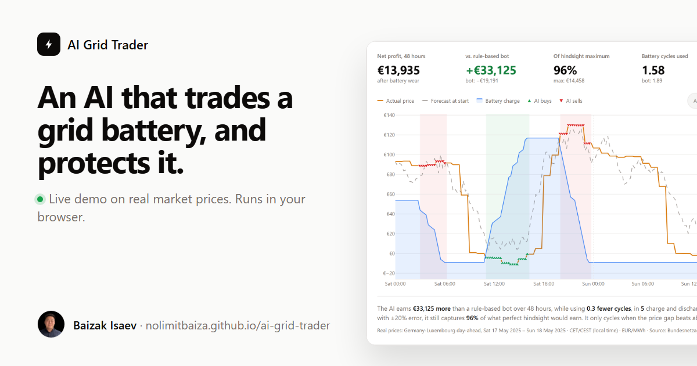

# AI Grid Trader

[](https://github.com/nolimitbaiza/ai-grid-trader/actions/workflows/test.yml)
[](https://baizakisaev.com/ai-grid-trader)
[](LICENSE.md)

**A browser-based simulator of AI-driven trading for grid-scale batteries.**

The agent buys electricity when it is cheap, sells when it is expensive, and treats battery wear as
a real cost. Try it on simulated markets, a full year of real prices from California, Germany and
South Australia, or your own price file.

**[Open the live demo](https://baizakisaev.com/ai-grid-trader)**

[](https://baizakisaev.com/ai-grid-trader)

The demo runs entirely in the browser, with no sign-up or backend, and works offline after the
first visit.

## Highlights

- **Honest benchmark.** The agent trades on a *forecast*, never the real future, and is scored
  on what actually happened. It's compared with perfect hindsight (the most any strategy could
  earn) and with a simple rule-based bot.
- **A full year of real prices** for three markets, with the agent re-planning every hour.
  It captures 93–95% of the hindsight maximum.
- **"Why this trade?"** Click any buy or sell to see what the AI expected, its margin after losses
  and wear, and what actually happened.
- **The whole business case:** grid services, capacity payments and co-located solar on top of
  trading, plus 15 years of battery health, replacement cells, NPV, IRR and payback.
- **Ready to present:** auto-play kiosk mode, a one-page PDF business case, shareable
  scenario links, light and dark themes, works offline.

## Results

Full-year simulation with the default 100 MWh / 25 MW battery on 2025 prices:

| Market | AI energy-trading revenue | Of hindsight max | Rule-based bot | ROI, trading only | ROI, all streams |
|---|---|---|---|---|---|
| California | $0.87M | 95% | −$0.36M | 4.4% | 13.6% |
| Germany | €2.54M | 95% | −€0.55M | 12.4% | 15.5% |
| South Australia | A$8.18M | 93% | +A$1.33M | 21.2% | 21.2% |

Revenue is after battery wear. "All streams" adds grid services and capacity payments. Results are
simulated and illustrative, and past prices don't guarantee future revenue.

## How it works

Every 15 minutes, the agent decides whether to charge, discharge or hold:

```text
reward = arbitrage cash − battery wear − micro-cycling penalty
```

The problem is modeled as a Markov decision process over time, state of charge and operating mode,
then solved exactly with dynamic programming. No model training is needed, so results are fast and
reproducible. In forecast mode the agent re-plans every hour using only a 24-hour forecast, and is
scored on the prices that actually occurred.

## Tech stack

| Area | Tools |
|---|---|
| Application | JavaScript, HTML, CSS, Plotly.js, Web Workers, service workers |
| Data pipelines | Python, with public data from CAISO, AEMO and Energy-Charts |
| Testing | Node.js test runner, Playwright, axe-core |
| Delivery | GitHub Actions, Docker, Caddy, Railway, Cloudflare |

## Run it locally

```bash
python tools/serve.py        # then open http://localhost:8600/
node --test tests/engine.test.js
```

GitHub Actions runs the model tests, browser checks in Firefox, Chromium and WebKit, an upgrade
check, and a production image smoke test on every push.

## Documentation

- [Methodology](docs/methodology.md): decision model, market data, revenue streams, costs and
  battery lifetime
- [User guide](docs/user-guide.md): presenting the demo, CSV uploads and accessibility
- [Development](docs/development.md): hosting, testing, data rebuilds and repository layout

## Author

Built by **Baizak Isaev**, a computer science student at North American University interested in
renewable energy. [Website](https://baizakisaev.com) ·
[LinkedIn](https://www.linkedin.com/in/baizakisaev/) · baizak@baizakisaev.com

## License

**PolyForm Noncommercial 1.0.0** (see [LICENSE.md](LICENSE.md)). You may use, study and modify
this code for non-commercial purposes such as learning, research and personal projects.
**Commercial use requires a separate license**: contact baizak@baizakisaev.com or
[LinkedIn](https://www.linkedin.com/in/baizakisaev/).

Third-party parts keep their own terms: Plotly.js (`assets/vendor/`, MIT license) and the market
data (each source's terms; the German data is CC BY 4.0, Bundesnetzagentur | SMARD.de).
